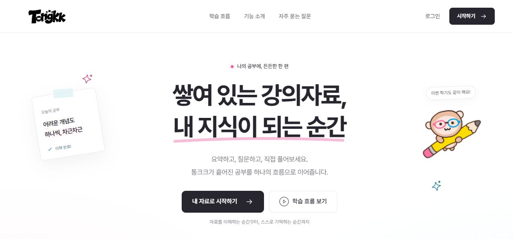
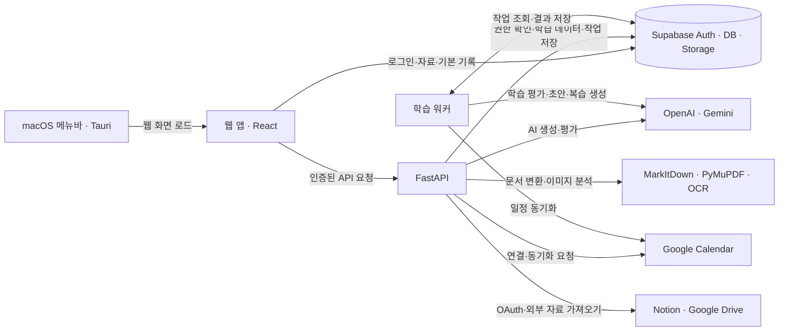

# Tongkk · 통크크

**내 공부가, 내 지식이 되는 곳.** 강의자료를 바탕으로 요약하고, 질문하고, 직접 설명한 뒤 복습까지 이어가는 AI 학습 서비스입니다.

<a href="https://tongkk.com/promo/">
  
</a>

<p align="center">
  <a href="https://tongkk.com/"><strong>서비스 시작하기 ↗</strong></a> &nbsp; · &nbsp;
  <a href="https://tongkk.com/promo/#preview">학습 흐름 체험 ↗</a> &nbsp; · &nbsp;
  <a href="https://tongkk.com/promo/#more-features">기능별 화면 둘러보기 ↗</a>
</p>

> **자료 준비 → 요약·튜터로 이해 → 퀴즈·자기 설명으로 확인 → 복습·암기 카드 → 다음 학습 계획**
>
> 웹에서 공부를 이어가고, macOS 메뉴바 앱에서 오늘 할 일과 튜터를 빠르게 확인합니다.

홍보 페이지에서는 로그인 없이 실제 앱 UI와 예시 데이터로 학습 흐름을 체험할 수 있습니다. 체험의 AI 답변·연동 결과는 준비된 예시이며, 내 자료와 학습 기록은 서비스에 로그인해 저장합니다.

## 핵심 기능

<table width="100%">
  <tr>
    <td width="50%" valign="top">
      <h3>자료 준비</h3>
      <p>PDF·PPT/PPTX·DOCX·이미지·TXT/Markdown 업로드와 텍스트 붙여넣기로 과목별 자료를 모읍니다.</p>
      <p>문서 변환·비전 분석·OCR로 내용을 읽고, 요약·퀴즈·설명 학습 초안을 검토해 저장합니다.</p>
    </td>
    <td width="50%" valign="top">
      <h3>4가지 AI 요약</h3>
      <p><strong>일반 요약 · 강의 노트 · 마인드맵 · 치트시트</strong>로 공부 방식에 맞게 정리합니다.</p>
      <p>페이지 범위·집중할 내용을 지정하고, 마인드맵을 펼쳐 보거나 결과를 복사·PDF로 내보냅니다.</p>
    </td>
  </tr>
  <tr>
    <td width="50%" valign="top">
      <h3>AI 튜터·학습 메이트</h3>
      <p>자료와 요약을 바탕으로 질문하고 대화를 저장합니다. 문장을 선택해 바로 묻거나 이미지를 첨부할 수 있습니다.</p>
      <p>학습 메이트로 다른 화면에서도 연결된 자료에 대한 질문을 이어갑니다.</p>
    </td>
    <td width="50%" valign="top">
      <h3>퀴즈·시험 모드</h3>
      <p><strong>객관식 · OX · 단답형 · 주관식</strong>을 난이도·문항 수·자료 범위에 맞춰 생성합니다.</p>
      <p>타이머, 주관식 AI 채점, 해설·오답 분석·다시 풀기로 이해를 확인합니다.</p>
    </td>
  </tr>
  <tr>
    <td width="50%" valign="top">
      <h3>직접 설명하는 학습</h3>
      <p>‘처음 배우기’ 또는 ‘수업 후 회상’에서 1~3개 개념을 자신의 말로 설명합니다.</p>
      <p>원문 근거·평가 기준에 따른 피드백과 힌트·확인 문제로 보완합니다. 설명 수정·재평가·이어하기도 지원합니다.</p>
    </td>
    <td width="50%" valign="top">
      <h3>복습 관리</h3>
      <p><strong>오늘 복습 · 학습 이슈 · 오답 문항</strong>을 한곳에서 확인합니다.</p>
      <p>보완할 개념을 다시 설명하고 새 사례의 문제로 점검하며, 도움 사용 여부와 복습 기록을 남깁니다.</p>
    </td>
  </tr>
  <tr>
    <td width="50%" valign="top">
      <h3>암기 카드</h3>
      <p>직접 작성하거나 자료에서 AI 초안을 만들고, 틀린 문제를 카드로 저장합니다.</p>
      <p>‘다시 · 어려움 · 알겠음 · 쉬움’ 자기평가에 따라 다음 복습 일정을 정합니다.</p>
    </td>
    <td width="50%" valign="top">
      <h3>학습 코스·연결 학습</h3>
      <p>같은 과목의 자료를 챕터로 묶고 순서·포함 여부를 편집합니다.</p>
      <p>개념 지도에서 원문 근거와 저장된 관계로 관련 개념을 연결하고, 추천 순서에 따라 학습합니다.</p>
    </td>
  </tr>
  <tr>
    <td width="50%" valign="top">
      <h3>학습 계획·캘린더</h3>
      <p>시험·과제 D-day, 오늘 할 일, 과목별 진도를 관리합니다.</p>
      <p>AI가 남은 일정과 미완료 항목을 바탕으로 오늘 할 일을 제안합니다.</p>
    </td>
    <td width="50%" valign="top">
      <h3>통계·개념별 기록</h3>
      <p>퀴즈 점수 추이·연속 학습일·학습 시간·취약 주제·과목별 성취도를 확인합니다.</p>
      <p>개념별 설명·복습 기록과 개념 지도로 다음에 공부할 내용을 찾습니다.</p>
    </td>
  </tr>
  <tr>
    <td colspan="2" valign="top">
      <h3>원문 근거 확인</h3>
      <p>요약·튜터·퀴즈의 출처를 눌러 <strong>PDF 해당 페이지나 변환 원문</strong>으로 이동합니다. 공부하는 흐름 안에서 원래 자료와 바로 비교할 수 있습니다.</p>
    </td>
  </tr>
</table>

암기 카드의 자기평가와 설명 학습의 수행 평가는 별도로 기록합니다. 학습 메이트 패널은 퀴즈 풀이와 설명 학습 화면에서는 숨겨집니다. 자료 자동 준비와 새 복습 문항 생성에는 [별도 학습 워커](#학습-워커)가 필요합니다.

## 외부 연동과 확장 화면

### 외부 자료·일정 연결

| 연동 | 구현 범위 | 현재 제공 상태 |
| --- | --- | --- |
| **Notion** | 허용한 페이지를 제목으로 검색 → 본문 가져오기 → 이전 본문과 비교 → 과목의 새 자료 버전으로 저장 | 마이페이지에서 연결. 서버 OAuth 설정과 사용자 접근 권한 필요 |
| **Google Drive** | Google 문서·텍스트·Markdown·PDF·PPTX·DOCX를 읽기 전용으로 가져와 새 자료 버전으로 저장 | API·연결 컴포넌트 구현, 현재 연결 UI 미노출 |
| **Google Calendar** | 기본 캘린더 일정 가져오기, 과목 연결, 자동 동기화 간격 설정 | 마이페이지에서 연결. 서버 OAuth 설정·사용자 접근 권한·학습 워커 필요 |

외부 자료와 일정의 원본은 변경하지 않습니다. OAuth 토큰 교환·암호화·갱신은 서버에서 처리합니다. 실제 연결에 필요한 설정은 [백엔드 연동 안내](server/README.md)를 참고하세요.

### macOS 메뉴바 앱

메뉴바 팝오버에서 **D-day·오늘 할 일 확인과 완료 처리**, **자료별 AI 튜터 질문**을 제공합니다. 전역 단축키, Mac 로그인 시 자동 실행, 테마, 오늘 할 일·시험/과제 하루 전 알림을 설정할 수 있습니다. 알림은 앱이 실행 중일 때 동작하며, 웹 브라우저와 앱의 로그인 세션은 별도입니다.

[Mac 앱 다운로드](https://github.com/yecnz/tongkk/releases/latest/download/Tongkk.dmg) · [메뉴바 화면 체험](https://tongkk.com/promo/#feature-menubar)

### 교수자 공간 · 미리보기

`/teachers`에서 학생별 진도·취약 개념을 살펴보고, PDF·TXT·Markdown 자료를 바탕으로 퀴즈·과제·수업 계획 초안을 만들고 편집할 수 있습니다. **현재 학생·통계는 예시 데이터이며, 자료와 초안은 해당 브라우저에만 저장됩니다.** 초안 생성은 로컬 규칙을 사용하며 실제 학생 계정이나 AI 서버와 연결되지 않습니다.

## 서비스 구조



- **프론트엔드**는 Supabase로 로그인·자료·기본 기록을 관리하고, AI 처리와 학습 워크플로는 FastAPI에 요청합니다.
- **백엔드**는 문서 변환·AI 생성 외에 학습 세션, 복습, 개념 관계, 학습 코스, 외부 연동과 서버 전용 DB 작업을 담당합니다.
- **학습 워커**는 DB에 저장된 작업을 별도 프로세스에서 실행합니다. 활성화하면 중단된 작업의 제한적 재개와 예약 복습·동기화를 처리합니다.
- **데이터 접근**은 사용자 JWT/RLS와 서버 전용 RPC를 사용합니다. 서버 키와 외부 서비스 토큰은 브라우저에 전달하지 않습니다.
- **요청 경로**는 기본 `/api`입니다. 개발에서는 Vite가 `127.0.0.1:8000`으로, 운영에서는 Vercel이 `api.tongkk.com`으로 전달합니다. 외부 연동의 화면 노출 상태는 위 표를 따릅니다.

### 기술 스택

| 영역 | 기술 |
| --- | --- |
| 웹 | React 19, TypeScript 5.9, Vite 8, React Router 7, Tailwind CSS 4 |
| 콘텐츠 표시 | react-markdown, remark-gfm, KaTeX, PDF.js, 브라우저 인쇄, jsPDF·html2canvas |
| API·AI | Python 3.12, FastAPI, LangGraph·LangChain, OpenAI·Gemini |
| 문서 처리 | MarkItDown, PyMuPDF, Pillow, Tesseract, LibreOffice, Google Vision |
| 데이터·인증 | Supabase Auth·Postgres·Storage, RLS, 서버 전용 RPC |
| 데스크톱 | Tauri 2, Rust, macOS 메뉴바·전역 단축키·알림 |
| 검증·배포 | Vitest, pytest, PGlite, Vercel, Docker |

## 프로젝트 구조

```text
tongkk/
├─ src/
│  ├─ pages/                   # 대시보드·자료 요약·퀴즈·캘린더·통계·계정·메뉴바
│  │  └─ summary/              # 자료 상세·요약 결과·템플릿·퀴즈 생성 화면
│  ├─ features/
│  │  ├─ learningSession/      # 자기 설명·피드백·확인·결과·학습 재개
│  │  ├─ learningHistory/      # 개념별 기록·개념 지도·연결된 개념 학습
│  │  ├─ review/               # 복습 일정·학습 이슈·설명 수정·추천
│  │  ├─ flashcards/           # 암기 카드 생성·편집·복습
│  │  ├─ studyPath/            # 여러 자료를 묶은 학습 코스
│  │  ├─ preparation/          # 요약·퀴즈·설명 학습 초안 준비
│  │  ├─ learningMate/         # 현재 자료에 연결된 학습 메이트
│  │  ├─ sources/              # 원문·페이지 출처 보기
│  │  ├─ integrations/         # Notion·Drive·Calendar 연결 화면과 콜백
│  │  └─ teachers/             # 교수자 공간 미리보기·로컬 초안
│  ├─ components/              # AI 튜터·PDF 뷰어·마인드맵·공용 UI
│  ├─ services/                # Supabase·API 호출, 자료·퀴즈·계획 등 도메인 로직
│  ├─ styles/                  # 학습 워크플로 공통 스타일
│  ├─ *Context.tsx             # 인증·과목·알림·튜토리얼·샘플 체험 상태
│  └─ App.tsx                  # 웹·학습·메뉴바·교수자 라우팅
├─ server/
│  ├─ main.py                  # API 구성·문서 변환·요약·튜터·퀴즈·계획
│  ├─ learning_sessions/       # 세션 라우터·서비스·생성·스키마·DB 저장소
│  ├─ reviews.py / review_schedule.py
│  ├─ learning_issues.py / explanation_revisions.py
│  ├─ concept_graph.py / concept_connections.py / concept_history.py
│  ├─ flashcards.py / study_paths.py
│  ├─ learning_mate.py / preparation.py
│  ├─ workflow.py / worker.py  # 작업 예약·영속 실행·복구
│  ├─ source_integrations.py / calendar_integration.py
│  ├─ auth.py / login_security.py / request_limits.py
│  ├─ usage.py / convert_cache.py / conversion_jobs.py
│  ├─ tests/ / evaluation/     # 서버 회귀 검사·AI 품질 평가
│  └─ Dockerfile / requirements*.txt
├─ supabase/
│  ├─ schema.sql               # 신규 설치용 전체 스키마·권한·스토리지
│  └─ migrations/              # 기존 DB에 순서대로 적용할 변경
├─ src-tauri/                  # macOS 메뉴바 앱·네이티브 설정·권한·DMG
├─ promo/                      # 독립 홍보 페이지·실제 UI 기반 체험·배포 번들
├─ scripts/                    # DB 검사·배포 파일 복사·화면 미리보기 도구
├─ public/                     # 정적 리소스
├─ docs/ / notes/              # UI 문구·설계·구현 기록·QA 자료
├─ vite.config.ts              # 웹 빌드·개발 API 프록시
├─ vercel.json                 # 운영 API·promo·SPA 라우팅
└─ package.json                # 개발·빌드·검사·메뉴바 명령
```

## 로컬 실행

### 준비

- Node.js **20.19 이상**과 npm, Python **3.12**
- Supabase 프로젝트와 OpenAI API 키. 요약·튜터·퀴즈에서는 Gemini도 선택할 수 있으며, 설명 학습·학습 코스는 OpenAI 설정이 필요합니다.
- 문서 기능에 따라 LibreOffice(PPT 미리보기), Tesseract와 `kor+eng` 언어 데이터(OCR). Google Vision은 선택 사항입니다.

**새 DB**는 Supabase SQL Editor에서 [schema.sql](supabase/schema.sql)을 실행합니다. **기존 DB**는 [migrations/](supabase/migrations/)의 미적용 파일만 파일명 시간순으로 적용합니다. 전체 스키마를 기존 DB에 다시 실행하지 않습니다.

### 백엔드

```sh
cd server
python -m venv .venv
source .venv/bin/activate
# Windows PowerShell: .\.venv\Scripts\Activate.ps1
pip install --require-hashes -r requirements-dev.txt
cp .env.example .env
# .env에 Supabase·모델 키를 입력한 뒤 실행
uvicorn main:app --reload --host 127.0.0.1 --port 8000
```

[서버 상태](http://localhost:8000/health) · [로컬 API 문서](http://localhost:8000/docs)

### 프론트엔드

새 터미널의 프로젝트 루트에서 실행합니다.

```sh
npm ci
cp .env.example .env.local
# .env.local에 Supabase URL·anon key 입력
npm run dev
```

기본 접속 주소는 [localhost:5173](http://localhost:5173)입니다. `VITE_API_URL=/api`를 유지하면 Vite 프록시로 백엔드에 연결합니다.

### 학습 워커

자료 자동 준비·새 복습 문항 생성·예약 작업을 사용하려면 `server/.env`에 `LEARNING_WORKER_ENABLED=true`를 설정하고, **API를 다시 시작한 뒤 별도 터미널에서 워커도 실행**합니다. 아래 명령은 macOS/Linux 기준이며, Windows에서는 WSL 또는 Docker 환경을 사용합니다.

```sh
cd server
source .venv/bin/activate
python -m worker
```

워커와 API 모두 같은 서버 전용 Supabase 키·모델 설정을 사용합니다. 기본값 `false`에서는 학습 세션 평가 등을 API 프로세스 안에서 처리하므로 서버 재시작 후 자동 실행을 보장하지 않습니다. 자동 복습은 사용자별 설정도 켜야 합니다. 컨테이너 실행과 연동 설정은 [server/README.md](server/README.md)를 참고하세요.

### macOS 앱·홍보 페이지

- **메뉴바 개발:** macOS에 Rust 1.90 이상·Xcode Command Line Tools를 준비한 뒤 `npm run menubar:dev`를 실행합니다. 웹 개발 서버는 5173 포트에 함께 실행되므로 기존 서버가 같은 포트를 쓰고 있으면 종료합니다.
- **메뉴바 빌드:** `npm run menubar:build`. 앱·DMG는 `src-tauri/target/release/bundle/`에 생성됩니다. 배포 앱은 `https://tongkk.com/mini`를 불러오므로 웹 변경은 별도로 배포해야 합니다.
- **홍보 페이지:** `npm run build`가 배포 파일을 `dist/promo/`로 복사합니다. 실제 UI로 만든 체험 번들 갱신·검사는 [promo/README.md](promo/README.md)를 따릅니다. 운영에서는 `/promo/`로 제공됩니다.

## 환경 설정

전체 예시는 [프론트 환경 변수](.env.example)와 [서버 환경 변수](server/.env.example)에 있습니다.

| 위치 | 주요 변수 | 역할 |
| --- | --- | --- |
| `.env.local` | `VITE_SUPABASE_URL`, `VITE_SUPABASE_ANON_KEY` | 브라우저의 Supabase 연결·로그인 |
| `.env.local` | `VITE_API_URL` | 기본 `/api`. 미설정 시 `VITE_BACKEND_URL` → `/api` 순서로 사용 |
| `server/.env` | `SUPABASE_URL`, `SUPABASE_ANON_KEY` | 사용자 로그인 토큰 검증 |
| `server/.env` | `SUPABASE_SECRET_KEY` | 학습·복습·코스·연동의 서버 전용 DB 작업. 구형 `SUPABASE_SERVICE_ROLE_KEY`도 지원 |
| `server/.env` | `OPENAI_API_KEY`, `OPENAI_MODEL`, `GEMINI_API_KEY`, `GEMINI_MODEL` | AI 공급자·모델 선택 |
| `server/.env` | `LEARNING_SESSION_MODEL`, `LEARNING_SESSION_ENABLED` | 설명 학습 모델·새 세션 생성 허용 여부 |
| `server/.env` | `LEARNING_WORKER_ENABLED` | 별도 워커 사용 여부. 기본 `false` |
| `server/.env` | `FRONTEND_ORIGIN` | 프론트 주소·CORS·외부 연동 콜백 기준 |
| `server/.env` | `NOTION_CLIENT_ID`, `NOTION_CLIENT_SECRET`, `INTEGRATION_ENCRYPTION_KEY` | Notion OAuth와 토큰 암호화 |
| `server/.env` | `GOOGLE_DRIVE_CLIENT_ID`, `GOOGLE_DRIVE_CLIENT_SECRET` | Google Drive 연동을 활성화할 환경의 OAuth 설정 |
| `server/.env` | `GOOGLE_CALENDAR_CLIENT_ID`, `GOOGLE_CALENDAR_CLIENT_SECRET` | Google Calendar 연동을 활성화할 환경의 OAuth 설정 |
| `server/.env` | `VISUAL_ANALYSIS_*`, `GOOGLE_VISION_API_KEY` | 문서 비전 분석·이미지 OCR |
| `server/.env` | `AI_USAGE_DB`, `LOGIN_ATTEMPTS_DB_PATH` | AI 사용량·로그인 실패 기록을 보관할 서버 로컬 DB 경로 |

`SUPABASE_SECRET_KEY`와 모델 API 키, OAuth secret, 암호화 키는 **서버에만** 설정합니다. `ALLOW_NO_AUTH`는 운영에서 `false`를 유지합니다. 설명 학습용 서버 키가 없으면 해당 API는 설정 안내와 503을 반환합니다.

<details>
<summary>인증·비밀번호 재설정·로그인 제한 배포 설정</summary>

- Supabase **Authentication → URL Configuration**의 Site URL을 운영 프론트 주소로 지정하고 Redirect URLs에 `/auth`, `/auth/reset-password`를 등록합니다. 개발 주소도 사용하는 호스트·포트별로 추가합니다.
- 비밀번호 재설정 메일은 `/auth/reset-password`로 돌아옵니다. 기존 `/auth`·`/` 복구 링크도 전용 화면으로 이동합니다. 만료 링크는 재발송을 요청할 수 있습니다.
- Confirm email 설정에 따라 가입 후 인증 안내·재전송 또는 즉시 로그인을 제공합니다. 같은 종류·이메일의 메일 요청에는 60초 재전송 제한이 있습니다.
- `/auth/login`은 기본 5회 비밀번호 실패 시 15분간 잠급니다. 미인증 이메일·인증 서버 장애·메일/요청 제한은 비밀번호 실패에 포함하지 않습니다. Supabase 공개 Auth API의 Rate Limits·CAPTCHA도 별도로 설정합니다.

`LOGIN_FORWARD_CLIENT_IP=true`를 사용할 때는 아래 설정을 모두 완료합니다.

1. Supabase Auth의 IP 전달(`security_sb_forwarded_for_enabled`) 활성화
2. 서버의 `SUPABASE_SECRET_KEY` 설정
3. Uvicorn `--proxy-headers --forwarded-allow-ips`에 신뢰하는 프록시 주소만 지정하고, 외부 요청이 전달 헤더를 위조하지 못하도록 접근 경로 제한

서버는 ASGI `request.client`를 사용하며 브라우저의 전달 헤더를 직접 신뢰하지 않습니다. 자세한 운영 설정은 [백엔드 문서](server/README.md)를 참고하세요.

</details>

<details>
<summary>API·데이터 모델 빠른 안내</summary>

`/health`와 `/auth/login`을 제외한 기능 API는 Supabase 로그인 토큰을 요구합니다. 전체 요청·응답 스키마는 실행 중인 서버의 `/docs`에서 확인합니다.

| API 묶음 | 역할 |
| --- | --- |
| `/convert`, `/preview/pdf`, `/vision/ocr` | 문서 변환·PDF 미리보기·OCR |
| `/summarize`, `/summarize/stream`, `/agent`, `/learning-mate` | 요약·스트리밍·자료 기반 대화 |
| `/quiz`, `/quiz/grade-subjective`, `/quiz/analyze-wrong`, `/study-plan` | 출제·채점·오답 분석·학습 계획 |
| `/learning-sessions`, `/reviews`, `/learning-issues`, `/explanation-revisions` | 설명 학습·복습·학습 이슈·설명 개선 |
| `/learning-concepts`, `/learning-graph`, `/study-paths`, `/flashcards/generate` | 개념 기록·연결 학습·학습 코스·카드 초안 |
| `/preparation-requests`, `/learning-workflow` | 학습 초안·예약·개인 설정·데이터 정리 |
| `/source-integrations`, `/integrations`, `/usage` | 외부 자료·일정 연결·AI 사용량 |

데이터는 기본 학습 자료(`courses`, `materials`, `summaries`, `quiz_*`), 세션·개념·수행 근거(`learning_*`), 복습·설명 개선(`review_*`, `explanation_*`), 카드·코스(`study_flashcards`, `study_flashcard_reviews`, `study_paths`, `study_path_sessions`), 작업·초안(`background_jobs`, `preparation_*`), 외부 연결(`external_*`, `integration_oauth_states`)로 나뉩니다. 전체 테이블·소유권 정책·RPC는 [schema.sql](supabase/schema.sql)이 기준입니다.

스토리지는 `avatars`(공개), `course-materials`(비공개)를 사용합니다. AI 사용량·로그인 제한·문서 캐시용 SQLite는 운영 시 영속 디스크에 둡니다.

</details>

## 개발·검증 명령

| 명령 | 용도 |
| --- | --- |
| `npm run dev` | 웹 개발 서버 |
| `npm run build` / `npm run preview` | 웹·promo 배포 빌드 / 결과 미리보기 |
| `npm test` / `npx tsc -b` / `npm run lint` | 프론트 테스트·타입·코드 및 UI 규칙 검사 |
| `npm run test:learning-db` / `npm run test:workflow-db` | 학습 세션·작업 흐름의 DB 권한·상태 전이 검사 |
| `npm run test:flashcards-db` / `npm run test:study-paths-db` | 카드·코스·연결 학습 DB 검사 |
| `npm run test:security-db` | 참조 소유권·RPC·Storage 권한 회귀 검사 |
| `python -m pytest -q` | 서버 테스트. `server/`의 가상환경에서 실행 |
| `python scripts/evaluate_quality.py` | 고정 샘플 품질 회귀 검사(API 호출 없음). `server/`에서 실행, [평가 안내](server/evaluation/README.md) 참고 |
| `npm run menubar:dev` / `npm run menubar:build` | macOS 메뉴바 앱 개발 / 빌드 |

DB 검사는 자격 증명 없이 격리된 PGlite 환경에서 실행합니다. 실제 Supabase 마이그레이션 적용·모델 응답·외부 계정 연결 검증은 별도로 진행합니다.
