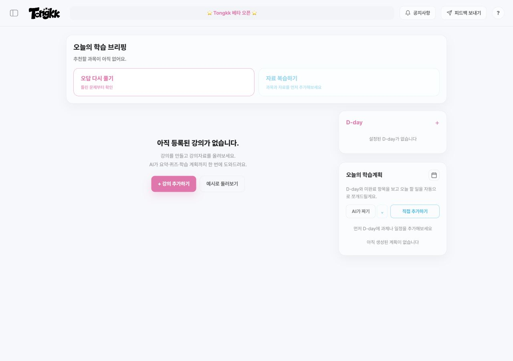
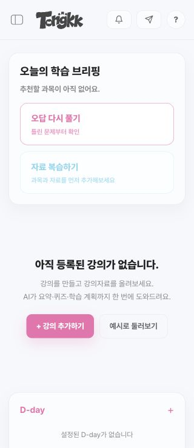
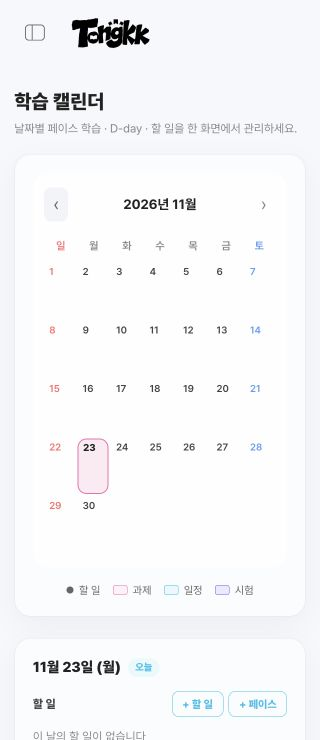
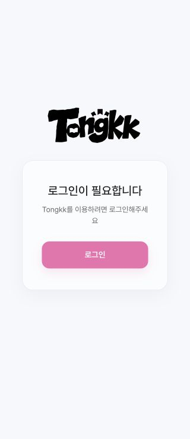
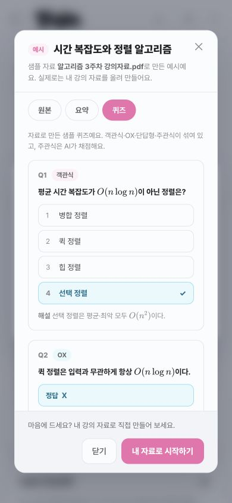
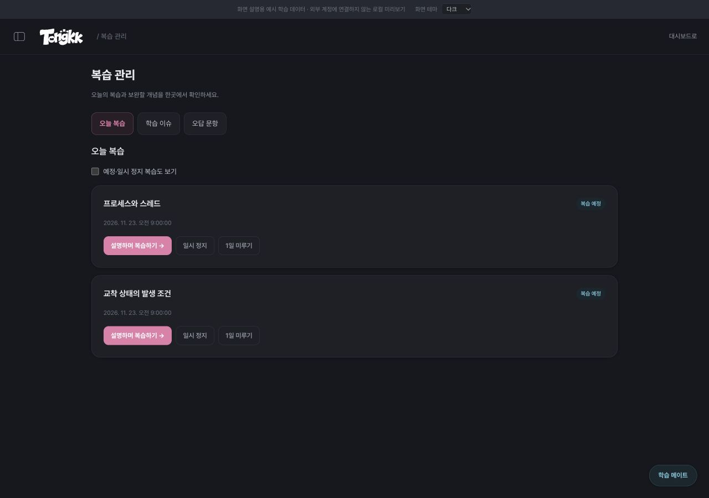
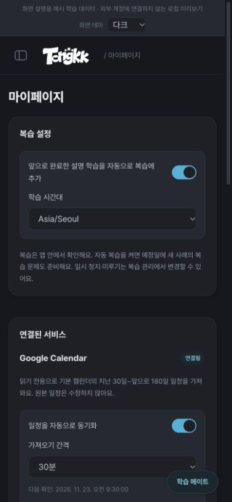
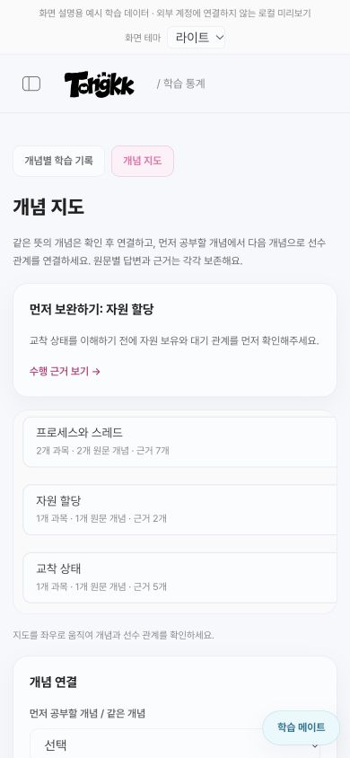

# 로고 교체 및 UI QA — 2026-11-23

제공된 `tongkk-logo-name.png`를 공통 `BrandLogo` 컴포넌트로 적용했다. 헤더·사이드바는 108×36px, 인증 화면은 216×72px로 표시하고 원본 비율과 투명 배경을 유지한다. 다크 모드에서는 CSS 필터로 흰색으로 표시한다. 이미지 자체는 수정하지 않았다.

## 발견한 문제와 수정

| 문제 | 수정 | 재확인 |
| --- | --- | --- |
| 모바일 예시 학습 창 하단 버튼이 좁아져 글자가 한 글자씩 줄바꿈됨 | 640px 이하에서는 설명과 버튼을 두 줄로 배치하고 버튼 폭 축소·문자 줄바꿈 방지 | 390px 배포 빌드에서 정상 표시 |
| 320px 대시보드에서 도움말 버튼이 오른쪽으로 넘침: 문서 폭 329px | 모바일 헤더 간격·좌우 여백 조정, 좁은 공지 배너 숨김. 공지사항 버튼은 유지 | 수정 후 뷰포트·문서 폭 모두 320px |
| 캘린더·통계·설정·자료 요약·퀴즈·기존 오답 화면 메뉴 버튼에 접근성 이름 없음 | `aria-label="메뉴 열기"` 추가 | 실제 캘린더·통계·설정의 접근성 트리에서 이름 확인 |
| 마이페이지 다크모드·알림 토글에 이름·상태 의미 없음 | `role="switch"`, `aria-label`, `aria-checked` 추가 | 다크모드 false·알림 true 상태 확인 |
| 화면 크기 선택이 색상으로만 구분됨 | 선택 버튼에 `aria-pressed` 추가 | 기본값 '보통' 선택 상태 확인 |

## 점검 범위

Chromium 기반 로컬 브라우저에서 실제 앱과 예시 데이터 미리보기를 구분해 검사했다. 기본 앱 배율은 0.9이며 모바일 크기는 CSS 뷰포트 기준이다.

| 대상 | 환경 | 결과 |
| --- | --- | --- |
| 실제 대시보드·캘린더·통계·마이페이지·복습 관리·인증 | 1280×900, 390×844, 320×740 | 로고 로딩·빈 상태·가로 넘침 확인. 위 수정 후 검사한 화면에서 문서 가로 넘침 없음 |
| 실제 메뉴·로고 | 모바일·데스크톱 | 사이드바 열기, 캘린더 이동, 로고 홈 이동 확인 |
| 실제 캘린더 | 모바일 | 11월→12월→11월 이동 확인 |
| 실제 로그인 모달 | 모바일 | 로그인→회원가입→로그인→비밀번호 찾기 전환 확인 |
| 실제 예시 학습 창 | 모바일·데스크톱 | 원본·요약·퀴즈 전환, 데스크톱 마인드맵 렌더링, 하단 버튼 확인 |
| 복습 목록·이슈 상세·개념 지도·개념 기록·연동 설정·자료 준비·복습 풀이·설명 개선 | 예시 데이터, 390×844 | 8개 화면의 문서 폭 390px, 깨진 이미지 0개. 개념 지도는 내부 가로 스크롤 유지 |
| 복습 관리·연동 설정 | 예시 데이터, 라이트·다크 | 로고·카드·입력·상태 표시 육안 점검 |
| 학습 메이트 | 예시 데이터, 데스크톱 다크 | 패널 열기·닫기 확인 |
| 최종 배포 빌드 | `vite preview`, 데스크톱·모바일 | 해시가 붙은 로고 자산 로딩 성공, 예시 학습 동작, 검사 구간 콘솔 error 0개 |

`metrics.json`의 `desktopInitial`은 접근성 수정 전 측정값이다. `productionNarrowAfterFix`는 최종 배포 빌드의 320px 재검사 결과다.

## 자동 검사

- `npm test -- --reporter=dot`: 26개 파일, 166개 테스트 통과.
- `npx tsc -b`: 통과.
- `npm run lint`: 오류 0개. 기존 Quiz useEffect 의존성 경고 4개 유지.
- `npm run build`: 통과. 기존 500kB 초과 청크 경고 유지.
- `git diff --check`: 통과.

## 범위의 한계와 후속 점검

- 로그인 계정을 사용하지 않았다. 실제 `/learn`은 인증 화면, 자료 없는 `/summary`·`/quiz`는 대시보드로 이동하는 것을 확인했다. 로그인 후 학습 화면은 기존 예시 데이터 미리보기와 앱 내 예시 학습 창으로 UI를 확인했다.
- 실제 OAuth 승인, 메일 발송, AI 생성, 업로드, 서버 데이터 저장·삭제는 수행하지 않았다. Google Drive·Notion·Calendar의 실제 계정 연동 성공을 의미하지 않는다.
- 개발 중 공통 모듈 HMR 후 인증 컨텍스트 오류가 일시적으로 기록됐다. 전체 새로고침 후 화면을 재확인했으며 최종 배포 빌드 검사 구간에는 콘솔 오류가 없었다.
- Safari·Firefox·실물 모바일 기기, 전체 키보드 순회·스크린리더·색 대비 기준 검증은 이번 범위에 포함하지 않았다.
- 원본 로고 자산은 약 890kB다. 더 작은 화면용 자산을 별도 제공하면 첫 로딩 전송량을 줄일 수 있다.

## 캡처

실제 앱:

아래 세 장은 화면 상단에 표시된 것처럼 **예시 데이터 미리보기**다.

